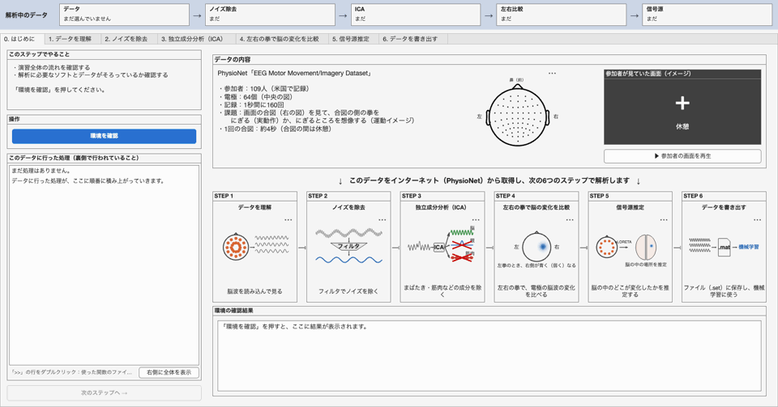
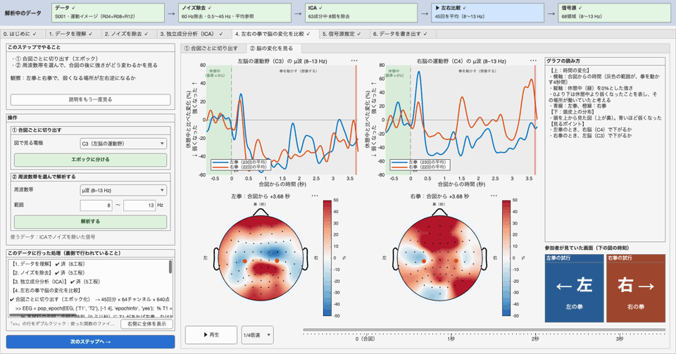
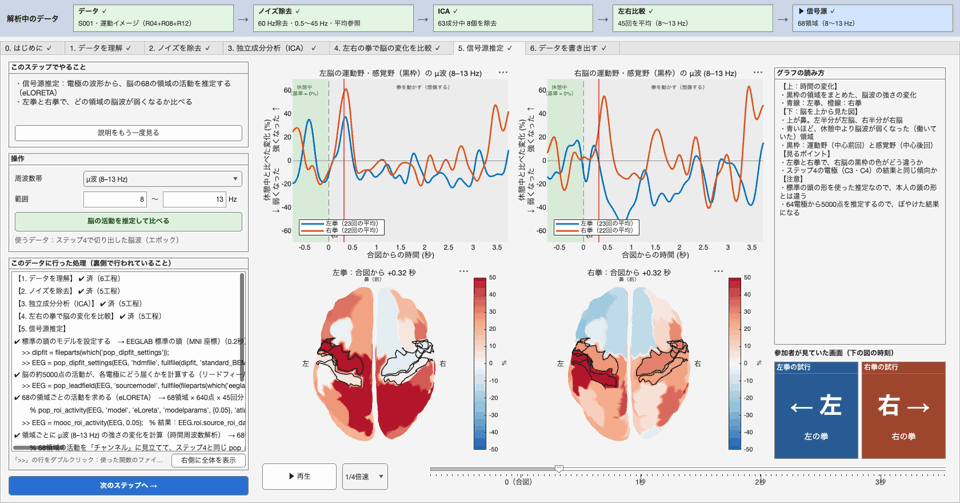
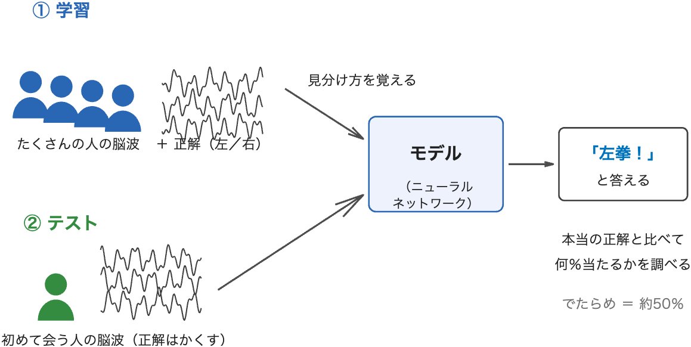
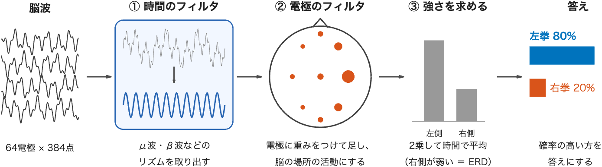

# MOOC2026 脳波解析演習（EEGLAB + MATLAB）

[](https://matlab.mathworks.com/open/github/v1?repo=MATLAB-TA/MOOC2026-EEG)

本物の脳波データを使って、**「頭の中で左右どちらの拳を動かそうとしたか」を脳波から読み取る**演習です。中高生〜大学生向けです。

- **パート1（アプリ）**：1人分の脳波を、ボタン操作で1ステップずつ解析します（ノイズ除去 → 独立成分分析 → 左右の比較 → 脳のどこが働いたかの推定）。
- **パート2（機械学習）**：104人分の脳波で、左右を当てるモデルを作ります。設定を変えて正解率を比べます。

上のボタンを押すと、ブラウザの MATLAB Online でこの演習が開きます。パソコンに何もインストールする必要はありません。



## 使うデータ

PhysioNet の [EEG Motor Movement/Imagery Dataset v1.0.0](https://physionet.org/content/eegmmidb/1.0.0/) を使います。109人が頭に64個の電極を付けて記録した脳波で、1秒あたり160点の記録です。

参加者は、画面の左右に出る合図に合わせて、次の2つの課題を行いました。

- **運動イメージ（本編）**：左右の拳を握るところを想像する（記録 R04・R08・R12）
- **実動作（比較用）**：左右の拳を実際に握る（記録 R03・R07・R11）

## はじめかた

### 1. 演習を開く

- **MATLAB Online（おすすめ）**：上の「Open in MATLAB Online」ボタンを押します。MathWorks アカウントでサインインすると、この演習のファイルが MATLAB Drive にコピーされ、そのフォルダが「現在のフォルダー」として開きます。「現在のフォルダー」の一覧から `setup.m` をダブルクリックして開きます。
- **デスクトップ版の MATLAB**：このリポジトリをクローンするか、「Code → Download ZIP」でダウンロードし、そのフォルダを MATLAB の「現在のフォルダー」にします。

必要なもの：MATLAB R2025a 以降（動作確認は R2026b）、Signal Processing Toolbox、Deep Learning Toolbox（パート2のみ）

### 2. 準備する（`setup.m`）

`setup.m` は、説明を読みながらセクションごとに実行する Live Script です。上から順に「セクションを実行」を押すと、必要なものを演習フォルダの中の `external/` にダウンロードします。演習フォルダの外は変更しません。

| セクション | ダウンロードするもの | 大きさ |
|---|---|---|
| 1 | EEGLAB 2026.0.0（脳波解析のツール） | 約30 MB |
| 2 | EEGLAB のプラグイン：firfilt・ICLabel・dipfit・FieldTrip-lite・ROIconnect | 約160 MB |
| 3 | BioSig（脳波のファイルを読み込むツール） | 約5 MB |
| 4 | 脳波データ：`subjects` で指定した参加者（最初は S001〜S005） | 1人 約15 MB |
| 5 | 機械学習用のデータ：104人 × 2課題（この演習の [GitHub リリース](https://github.com/MATLAB-TA/MOOC2026-EEG/releases/tag/v1.0)） | 約3 GB |
| 6 | 確認（「準備ができました」と表示されれば完了） | — |

- 同じセクションを2回実行しても大丈夫です。済んでいるものは飛ばし、途中で止まったものは続きから行います。
- ほかの参加者も解析したいときは、セクション4の `subjects` を変えて実行し直します（例：`subjects = [1 2 3 10 20];`）。

### 3. 演習を進める

```matlab
launch_app            % パート1：アプリを起動する
```

パート2は、`machine_learning.m` を開き、セクションを上から順に実行します。

## パート1：アプリで1人分の脳波を解析する

`launch_app` で開くアプリには、7つのタブがあります。左から順に進めると、ステップ1で選んだ1人分の脳波が、少しずつきれいになり、分析されていきます。

| タブ | やること |
|---|---|
| 0. はじめに | 使うデータと、6つのステップの流れを知る。環境（ツールが入っているか）を確かめる |
| 1. データを理解 | 解析する記録を選んで読み込む。脳波の波形と電極の位置を見て、実験の様子（参加者が見ていた画面）を再生する |
| 2. ノイズを除去 | 電源のノイズ（60 Hz）や、ゆっくりした揺れを取り除く。取り除く前と後を、波形と周波数のグラフで比べる |
| 3. 独立成分分析（ICA） | 混ざり合った脳波を、もとの信号（成分）に分ける。まばたき・筋肉などのノイズの成分を ICLabel で見分けて取り除く |
| 4. 左右の拳で脳の変化を比較 | 合図ごとに脳波を切り出し、左拳と右拳で μ波・β波の強さがどう変わるか（ERD）を、頭皮の図の動画で比べる |
| 5. 信号源推定 | 頭皮の脳波から、脳の68の領域それぞれの活動を推定し、脳の図の動画で見る |
| 6. データを書き出す | 処理した脳波を EEGLAB のデータセット（.set）として保存する。行った処理のコードも、ファイルの中（`EEG.history`）に保存される |

**ステップ4：左右の拳で、頭皮の脳波の強さはどう変わるか**（青：弱くなる、赤：強くなる）



**ステップ5：脳のどの領域が働いたか**



### アプリのしくみ

- **行った処理がコードで見える**：各タブの左側の「このデータに行った処理」に、ボタンを押すたびに実行した EEGLAB のコード（例：`EEG = pop_eegfiltnew(...)`）が積み上がります。行をクリックすると、その関数のファイルが MATLAB のエディタで開きます。
- **やり直しができる**：各段階の結果は保存されています。ある段階をやり直すと、それより後ろの結果だけが消えます（例：ICA で取り除く成分を変えても、数分かかる ICA の計算はやり直しません）。
- **ボタンの色**：青いボタンが「次に押すボタン」です。済んだ段階は薄い緑、まだ押せないボタンは灰色になります。
- **書き出したデータは機械学習にも使える**：ステップ6で保存するファイルは、パート2の機械学習用のデータと同じ形式です。

## パート2：機械学習で、脳波から「左の拳か、右の拳か」を当てる

`machine_learning.m` は、アプリと同じ処理をした **104人分** の脳波を使って、脳波から左右を当てるモデルを作る Live Script です。



- **学習**：たくさんの人の脳波と正解（左か右か）をモデルに見せて、見分け方を覚えさせます。
- **テスト**：学習に使っていない人の脳波で、どれだけ当たるかを調べます。初めて会う人の脳波も当てられるかを確かめるためです。
- 左右の2択なので、でたらめに答えても約50%は当たります。**50%をどれだけ上回るか**が、モデルの実力です。最初の設定では、約75%当たります（学習に10分ほどかかります）。

### 流れ

| セクション | 内容 |
|---|---|
| 0. 準備 | EEGLAB を起動し、Deep Learning Toolbox があるかを確かめる |
| 1. 設定 | 何を使って、どのモデルで学習するかを、ドロップダウンやチェックボックスで選ぶ |
| 2. データを読み込む | 1人ずつ `pop_loadset` で読み込み、選んだ電極と時間を取り出す。人ごとの脳波の違いをそろえる（Euclidean Alignment） |
| 3. 人を分ける | テスト用20人・確認用10人・学習用に分ける。同じ人が学習とテストの両方に入らないようにする |
| 4. モデルを作る | EEGNet（脳波の分類でよく使われる畳み込みニューラルネットワーク）を、Deep Learning Toolbox の層を並べて作る |
| 5. 学習する | 確認用の人の正解率を見ながら学習し、最もよかった時点のモデルを使う（過学習を防ぐ） |
| 6. テストする | テスト用の20人で正解率を調べる。混同行列と、人ごとの正解率を見る |
| 7. どこを見て判断したか | 電極を1つずつ隠して、正解率がどれだけ下がるかを調べる |
| 8. 結果を記録して比べる | 設定と正解率を `outputs/ml_results.csv` に1行ずつ記録し、表で比べる |

モデルの EEGNet は、アプリで行った処理と似たことを、学習で自分で見つけます。



1. **時間のフィルタ**：波形から μ波・β波などのリズムを取り出す（アプリのステップ2のフィルタにあたる）
2. **電極のフィルタ**：電極に重みをつけて足し、脳のある場所の活動を取り出す（ステップ3の ICA や、ステップ5の信号源推定にあたる）
3. **強さを求めて分類**：取り出したリズムの強さから、左右を判断する（ステップ4の ERD にあたる）

### 変えられる設定（セクション1）

1回目はそのまま実行し、2回目からは設定を1つずつ変えて正解率を比べます。

| 設定 | 選べるもの |
|---|---|
| 課題 | 運動イメージ／実動作 |
| データの種類 | 頭皮の64電極／脳の68領域（アプリのステップ5と同じ信号源推定の結果） |
| 使う場所 | 全部／運動に関わる場所（C3・Cz・C4 のまわり）／後頭部 |
| 使う時間 | 合図から何秒後までの脳波を使うか（例：0〜3秒） |
| モデル | CNN（波形をそのまま入力する EEGNet）／μ波・β波の強さを入力する小さなニューラルネットワーク |
| 学習に使う人数 | 1〜74人 |
| 人ごとの違いをそろえる | あり／なし |
| もう一方の課題も学習に使う | あり／なし（学習データが2倍になる） |
| キャリブレーションの試行数 | 0・5・10・20（実際に BCI を使うときのように、最初の数試行だけで調整する） |

## 機械学習用のデータの中身

`external/mooc_dataset/imagery/S###_imagery.set`（運動イメージ）と `movement/S###_movement.set`（実動作）が104人分あります。アプリのステップ6で書き出すファイルと同じ形式の EEGLAB のデータセットで、`EEG = pop_loadset('S001_imagery.set');` で読み込めます。

| 中身 | 大きさ | 内容 |
|---|---|---|
| `EEG.data` | 電極 × 時間 × 試行 | 脳波（µV）。64 電極 × 640 点（−1〜4 秒）× 45 試行 |
| `EEG.roi.source_roi_data` | 領域 × 時間 × 試行 | 信号源推定で求めた、脳の68領域の活動 |
| `EEG.roi.atlas.Scouts` | 1 × 領域 | 領域の名前（`Label`、例：`precentral L`） |
| `EEG.etc.mooc.labels` | 試行 × 1 | 試行ごとの合図（`"left_fist"` 左拳／`"right_fist"` 右拳） |
| `EEG.times` / `EEG.srate` | — | 合図からの時間（ミリ秒）／1秒あたりの点の数（128） |
| `EEG.chanlocs` | 1 × 電極 | 電極の名前と位置 |
| `EEG.history` | 文字 | このデータに行った処理のコード |

アプリとの違いは1つだけです。ICA を、運動イメージと実動作の6回分の記録をまとめて1回だけ計算しています（両方の課題で同じ成分を取り除くため）。

## 既定の解析設定（`src/mooc_default_config.m`）

| 項目 | 既定値 | 理由 |
|---|---|---|
| ノッチ | 60 Hz | 米国で記録されたデータのため（電源の周波数） |
| バンドパス | 0.5〜45 Hz | 運動に関係する μ波（8〜13 Hz）と β波（13〜30 Hz）を含む範囲を残す |
| リサンプリング | 128 Hz | 160 Hz から間引いて、計算を軽くする |
| 再参照 | 共通平均参照（CAR） | 全電極の平均を基準にする |
| 取り除く成分 | ICLabel で「脳」「その他」以外と判定された成分 | まばたき・筋肉・心臓などのノイズを取り除く |
| エポック | −1〜4 秒 | −1〜0 秒は休憩（基準）、0〜4 秒は課題 |
| 使わない参加者 | S088・S089・S092・S100・S104 | 記録のしかた（1秒あたりの点の数・合図の記録）がほかと異なる |

## フォルダの構成

```text
MOOC2026-EEG/
├── setup.m                 # 最初に1回：必要なものをダウンロードする（Live Script）
├── launch_app.m            # パート1：アプリを起動する
├── machine_learning.m      # パート2：機械学習（Live Script）
├── src/                    # アプリなどから呼ばれる関数
│   ├── mooc_default_config.m   # 解析の設定とフォルダの場所
│   ├── io/                 # データの読み込み・書き出し
│   ├── analysis/           # ERD と、脳の領域ごとの活動の計算
│   ├── plot/               # 図を描く
│   └── app/                # アプリ（steps/ に1タブ1ファイル、ui/ に共通の部品）
├── external/               # setup.m がダウンロードしたもの（GitHub では空）
└── outputs/                # 書き出したデータと機械学習の結果
```

アプリのコードは、`src/app/steps/step_*.m` の1ファイルが1タブです。ボタンを押したときの処理は、「何をするか（日本語）」「使う関数」「対応するコード」を並べた形で書いているので、上から読めば処理の流れが分かります。解析は EEGLAB の `pop_` 関数で行い、アプリはそれを呼び出して結果を表示するだけです。

## 発展：関数を直接使う

アプリの「このデータに行った処理」と、書き出したファイルの `EEG.history` には、同じ処理のコードが並びます。主な部分は次のとおりです。

```matlab
addpath src; setup_eeglab;                                     % パスの設定と EEGLAB の起動
cfg = mooc_default_config();
EEG = mooc_import_run(1, 4, cfg);                              % S001 の R04（運動イメージ）
EEG = pop_chanedit(EEG, 'lookup', cfg.paths.channelLocationFile);
EEG = pop_eegfiltnew(EEG, 59, 61, [], 1);                      % 60 Hz の電源ノイズ
EEG = pop_eegfiltnew(EEG, 0.5, 45);                            % 0.5〜45 Hz を残す
EEG = pop_runica(EEG, 'icatype', 'runica', 'extended', 1, 'rndreset', 'off');
EEG = pop_iclabel(EEG, 'default');
[~, best] = max(EEG.etc.ic_classification.ICLabel.classifications, [], 2);
EEG = pop_subcomp(EEG, find(~ismember(best, [1 7])), 0);       % 脳・その他以外を除く
EEG = pop_epoch(EEG, {'T1', 'T2'}, cfg.epoch.windowSec, 'epochinfo', 'yes');   % -1〜4 秒
```

機械学習用のデータは `src/build_course_dataset.m` で作っています。脳波データを全員分ダウンロードすれば（`setup.m` のセクション4で `subjects = 1:109;`）、同じデータを自分で作り直せます（1人あたり約3分）。

## 環境についての注意

- Apple Silicon の Mac では、ICLabel が最初に「MEX-file compilation failed」と表示します。そのあと MATLAB で計算するので、結果は同じです。
- ダウンロードを行うのは `setup.m` だけです。アプリと `src/` の関数はインターネットに接続しません（EEGLAB は起動時に、プラグインの新しい版があるかを確認します）。

## ライセンス

この演習は、使っているソフトウェアとデータのライセンスに合わせて、次のように配布します。

| 対象 | ライセンス | 理由 |
|---|---|---|
| プログラム（`.m` ファイル。`setup.m`・`launch_app.m`・`machine_learning.m`・`src/` など） | [GNU GPL 3.0 以降](LICENSE) | FieldTrip・BioSig（GPL 3.0）や firfilt・dipfit（GPL 2.0 以降）の関数を呼び出して動くため、これらすべてと両立する GPL 3.0 以降にする。BSD 2-Clause の EEGLAB・ICLabel・ROIconnect とも両立する |
| 機械学習用のデータ（[リリース v1.0](https://github.com/MATLAB-TA/MOOC2026-EEG/releases/tag/v1.0) の zip） | [Open Data Commons Attribution License v1.0](https://opendatacommons.org/licenses/by/1-0/) | 元の脳波データ（PhysioNet）のライセンスを引き継ぐ |
| 説明の画像（`docs/images/`） | [CC BY 4.0](https://creativecommons.org/licenses/by/4.0/deed.ja) | 出典を示せば自由に使えるようにする |

使うときは、下の「参考資料」にある元のデータとソフトウェアの文献も引用してください。

## 参考資料

### 脳波データ

この演習の脳波データは、PhysioNet の [EEG Motor Movement/Imagery Dataset v1.0.0](https://physionet.org/content/eegmmidb/1.0.0/) です。ライセンスは [Open Data Commons Attribution License v1.0](https://physionet.org/content/eegmmidb/view-license/1.0.0/) です。機械学習用のデータ（[リリース v1.0](https://github.com/MATLAB-TA/MOOC2026-EEG/releases/tag/v1.0) の zip）は、このデータを EEGLAB で処理して作った派生データで、同じライセンスで配布しています。使うときは、次の文献を引用してください。

- Schalk, G. (2009). EEG Motor Movement/Imagery Dataset (version 1.0.0). PhysioNet. https://doi.org/10.13026/C28G6P
- Schalk, G., McFarland, D. J., Hinterberger, T., Birbaumer, N., & Wolpaw, J. R. (2004). BCI2000: A General-Purpose Brain-Computer Interface (BCI) System. *IEEE Transactions on Biomedical Engineering*, 51(6), 1034–1043.
- Goldberger, A. L., et al. (2000). PhysioBank, PhysioToolkit, and PhysioNet: Components of a new research resource for complex physiologic signals. *Circulation*, 101(23), e215–e220.

### 使っているソフトウェアとライセンス

このリポジトリには、ほかの人が作ったソフトウェアは入っていません。`setup.m` が、それぞれの配布元から `external/` にダウンロードします（`external/` は GitHub では空です）。`src/` の関数は、これらの関数を呼び出して使っています。

| ソフトウェア・データ | 使うところ | ライセンス |
|---|---|---|
| [EEGLAB](https://eeglab.org/) 2026.0.0 | 解析の全体（ICA の `runica` など） | BSD 2-Clause |
| [firfilt](https://github.com/widmann/firfilt) 2.8 | フィルタ（`pop_eegfiltnew`） | GPL 2.0 以降 |
| [ICLabel](https://github.com/sccn/ICLabel) 1.7 | 成分の種類の判定 | BSD 2-Clause（一部のファイルは GPL 2.0 以降） |
| [dipfit](https://github.com/sccn/dipfit) 5.6 | 信号源推定の頭のモデル | GPL 2.0 以降・BSD 2-Clause（ファイルごと） |
| [FieldTrip](https://www.fieldtriptoolbox.org/)-lite 250523 | リードフィールドの計算（dipfit から） | GPL 3.0 |
| [ROIconnect](https://github.com/sccn/roiconnect) 1.1 | eLORETA と、領域ごとの活動 | BSD 2-Clause（ファイルごと） |
| [BioSig](https://biosig.sourceforge.net/) 3.8.5 | EDF ファイルの読み込み | GPL 3.0 |
| Colin27 の頭のモデル（EEGLAB に同梱） | 信号源推定 | McGill University（著作権表示を残せば利用・再配布可） |
| [MATLAB](https://www.mathworks.com/products/matlab.html)・Signal Processing Toolbox・Deep Learning Toolbox | 全体 | MathWorks の製品（使う人がそれぞれライセンスを持つ必要がある） |

### 文献

使ったソフトウェアと手法の文献です。

- EEGLAB：Delorme, A., & Makeig, S. (2004). EEGLAB: an open source toolbox for analysis of single-trial EEG dynamics including independent component analysis. *Journal of Neuroscience Methods*, 134(1), 9–21.
- ICLabel：Pion-Tonachini, L., Kreutz-Delgado, K., & Makeig, S. (2019). ICLabel: An automated electroencephalographic independent component classifier, dataset, and website. *NeuroImage*, 198, 181–197.
- firfilt：Widmann, A., Schröger, E., & Maess, B. (2015). Digital filter design for electrophysiological data – a practical approach. *Journal of Neuroscience Methods*, 250, 34–46.
- FieldTrip：Oostenveld, R., Fries, P., Maris, E., & Schoffelen, J.-M. (2011). FieldTrip: Open source software for advanced analysis of MEG, EEG, and invasive electrophysiological data. *Computational Intelligence and Neuroscience*, 2011, 156869.
- ROIconnect：Pellegrini, F., Delorme, A., Nikulin, V., & Haufe, S. (2023). Identifying good practices for detecting inter-regional linear functional connectivity from EEG. *NeuroImage*, 277, 120218.
- BioSig：Vidaurre, C., Sander, T. H., & Schlögl, A. (2011). BioSig: The free and open source software library for biomedical signal processing. *Computational Intelligence and Neuroscience*, 2011, 935364.
- eLORETA：Pascual-Marqui, R. D. (2007). Discrete, 3D distributed, linear imaging methods of electric neuronal activity. arXiv:0710.3341
- Colin27：Holmes, C. J., et al. (1998). Enhancement of MR images using registration for signal averaging. *Journal of Computer Assisted Tomography*, 22(2), 324–333.
- 脳の68領域（Desikan-Killiany）：Desikan, R. S., et al. (2006). An automated labeling system for subdividing the human cerebral cortex on MRI scans into gyral based regions of interest. *NeuroImage*, 31(3), 968–980.
- EEGNet：Lawhern, V. J., et al. (2018). EEGNet: a compact convolutional neural network for EEG-based brain–computer interfaces. *Journal of Neural Engineering*, 15(5), 056013.
- Euclidean Alignment：He, H., & Wu, D. (2019). Transfer learning for brain–computer interfaces: A Euclidean space data alignment approach. *IEEE Transactions on Biomedical Engineering*, 67(2), 399–410.
